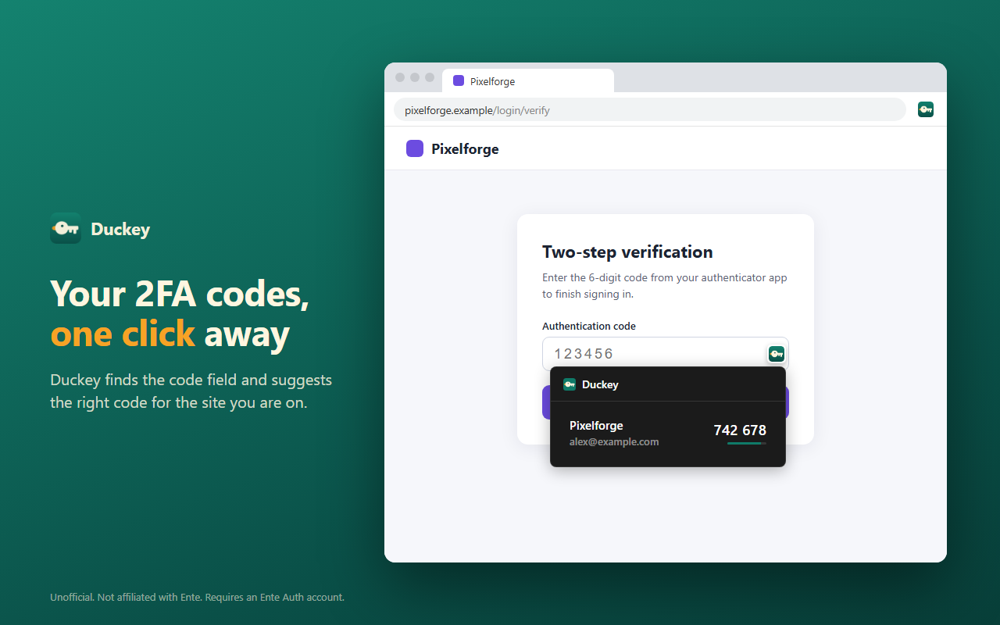

# Duckey: 2FA Autofill for Ente Auth

Duckey is a browser extension that autofills 2FA codes from your [Ente Auth](https://ente.io/auth) vault. (Ente is German for duck.)

Duckey was previously called **Ente Auth Extension**. It's the same project, renamed for its 1.0 release in the official browser stores. Same interface just new name, icon and colors (but you can switch back to ente purple in the settings if you want!)



> **Disclaimer**: This is an unofficial, community-developed browser extension. It is **not** developed, maintained, or officially supported by the Ente team. However, the Ente team has been made aware of this extension, and I am happy to collaborate with them when the time is right. Use at your own discretion.

## Features

- **Autofill**: finds 2FA code fields on websites, including split "one box per digit" inputs, and fills the right code with one click
- **Smart matching**: suggests codes for the site you're on, with custom domain mappings when automatic matching misses
- **Your whole vault in the toolbar**: view, search, copy, add, edit and delete codes
- **Add codes by scanning** a QR code on the current page
- **Tags and pins** to organize your codes
- **Vault timeout and PIN unlock**: lock on restart, on system lock or after idle time, and unlock with a quick PIN
- **Themes**: light, dark or system, with Duckey green, Ente purple or your own accent color. The toolbar icon follows your accent color.
- **Syncs** with your Ente Auth account, end-to-end encrypted
- **Passkey support** through Ente Accounts
- **Self-hosted support**: point Duckey at your own Ente server
- **Cross-browser**: Chrome, Edge and Firefox

## Installation

### From the browser stores (recommended)

- **Chrome**: Chrome Web Store (link coming soon)
- **Edge**: Microsoft Edge Add-ons (link coming soon)
- **Firefox**: Firefox Add-ons (link coming soon)

Only install Duckey from these listings or from this repository's releases. Copies published elsewhere aren't from this project.

If you installed an earlier version unpacked or from a GitHub release, remove that copy after installing from the store.

### From a GitHub release

1. Download the latest release for your browser from the [Releases page](../../releases):
   - **Chrome / Edge**: `duckey-chrome-x.x.x.zip`
   - **Firefox**: `duckey-firefox-x.x.x.zip`
2. Install it:

   **Chrome / Edge:**
   1. Extract the zip file
   2. Open `chrome://extensions` (or `edge://extensions`)
   3. Enable "Developer mode"
   4. Click "Load unpacked"
   5. Select the extracted folder

   **Firefox:**
   1. Open `about:debugging#/runtime/this-firefox`
   2. Click "Load Temporary Add-on" and pick the zip file

   > Temporary add-ons are removed when Firefox closes. For a permanent install, use Firefox Add-ons.

### From source

1. Clone this repository
2. Install dependencies:
   ```sh
   npm ci
   ```
3. Build the extension:
   ```sh
   # Build for both browsers (outputs to dist-chrome/ and dist-firefox/)
   npm run build

   # Build for a specific browser
   npm run build:chrome
   npm run build:firefox
   ```
4. Load the extension using the steps above, selecting the `dist-chrome` or `dist-firefox` directory

## Development

Start the development build with file watching:

```sh
npm run dev

# Watch a specific browser
npm run dev:chrome
npm run dev:firefox
```

This rebuilds the extension automatically when you make changes.

### Detector test pages

`test/index.html` lists test pages for 2FA field detection: pages where the autofill icon should appear and pages where it shouldn't (SMS codes, promo codes, access tokens and so on). Open them with the extension loaded to check detection changes.

## Directory Structure

```
ente-auth-extension/
├── assets/            # Extension icons
├── branding/          # Icon source SVGs and large logo
├── manifests/         # Browser-specific manifest files
├── src/
│   ├── background/    # Service worker (Chrome) / background script (Firefox)
│   ├── content/       # Content scripts for MFA detection and autofill
│   ├── login/         # Built-in login page (SRP, passkey, email OTT)
│   ├── options/       # Extension settings page
│   ├── popup/         # Browser toolbar popup UI
│   └── shared/        # Shared utilities (crypto, OTP, API, SRP, theming)
├── store-listing/     # Store screenshots, promo tiles and logo
├── test/              # Detector test pages
└── dist-*/            # Build outputs (gitignored)
```

## Authentication

Duckey has a built-in login page for your Ente account that supports:

- **SRP (Secure Remote Password)**: your password is checked without ever being sent to the server
- **Email OTT**: a one-time code sent to your email, as a fallback
- **Passkeys**: opens the Ente Accounts site your server specifies for WebAuthn verification, then waits for the result
- **TOTP two-factor**: standard authenticator app codes

For self-hosted Ente instances, set a custom server (and, if needed, accounts) URL on the login page or in settings. Once you're signed in, your 2FA codes sync and are available from the toolbar popup.

## How Autofill Works

When you visit a page with a 2FA code field:

1. The content script detects the field from its attributes, label and surrounding text
2. A Duckey icon appears in the field
3. Click the icon to see the codes that match the site, and click one to fill it

With "Auto-fill single match" on, a single matching code is filled automatically.

Duckey matches codes to websites using each code's issuer name, built-in domain mappings for common services, and any custom mappings you add in settings.

## Privacy

Duckey has no analytics or tracking, and it only talks to the Ente server you sign in to. See [PRIVACY.md](PRIVACY.md) for details.

## Releasing

Store publishing, the CI release workflow and listing copy are documented in [PUBLISHING.md](PUBLISHING.md).

## Contributing

Contributions are welcome! Please see [CONTRIBUTING.md](CONTRIBUTING.md) for guidelines.

## Contact

Have questions, feedback, or want to get involved? Reach out to **iPcGuy** on the [Ente Discord server](https://discord.gg/z2YVKkycX3).

## License

This project is based on work from the [Ente](https://github.com/ente-io/ente) codebase, which is licensed under AGPL-3.0.

## Acknowledgments

- [Ente](https://ente.io) for the excellent Ente Auth app and open source ecosystem
